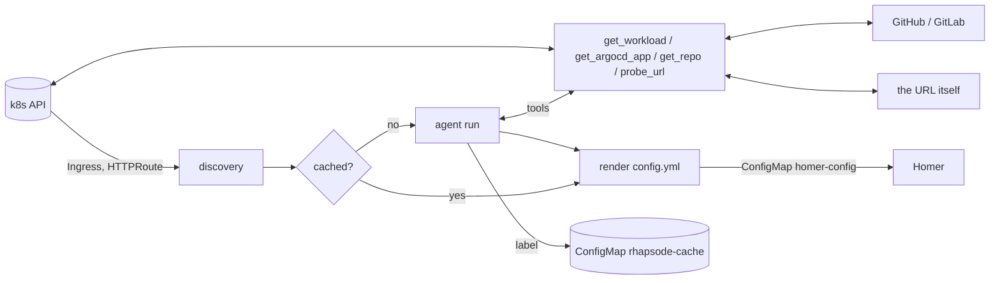

# rhapsode

Fills your [Homer](https://github.com/bastienwirtz/homer) dashboard with every public Kubernetes Ingress and Gateway API HTTPRoute. A Claude Agent SDK agent works out what each URL powers before it is listed.

Design, trade-offs and security model: [docs/design.md](docs/design.md).



## How it works

- Every `RECONCILE_INTERVAL_S` (default 60) it lists Ingresses and HTTPRoutes, and groups hostnames that share a namespace and Service into one **backend**.
- Each backend gets one short agent run, only when its hosts, Service, annotations or container images change. The run returns:
  - a label;
  - the primary hostname (the others become link pills on the card);
  - any API docs it found;
  - optionally a Homer smart card (Gatus, OliveTin).
  
  Each namespace gets one tiny run that titles its group. Everything is cached in a ConfigMap, so in steady state there are no LLM calls. A failed run gets a fallback label and is retried after `FAILURE_BACKOFF_S` (default 30 min).
- The agent has no built-in tools: no shell, no files, no web. It has five tools of its own:
  - `get_workload`: backend Service and pod info.
  - `get_argocd_app`: the Argo CD Application.
  - `get_repo`: a GitHub or GitLab repo's description plus its README or one file.
  - `probe_url`: a GET on a discovered host, without following redirects.
  - `find_api_docs`: checks the backend's own Service, in-cluster, at about 20 well-known OpenAPI, Swagger, ReDoc and Scalar paths.
- Output is a structured JSON label. It is still validated:
  - lengths are clamped;
  - `icon`, `category` and `smart_card` come from allowlists;
  - the primary host must be one of the backend's own;
  - API doc links are kept only for paths the tool confirmed.
  
  No URL comes from the model.
- The result goes to ConfigMap `homer-config`:
  - `config.yml`: every card, one group per namespace;
  - one page per category (`ai.yml`, `tools.yml`, …);
  - `apis.yml`, when any API docs exist.
  
  Homer's navbar links (`#rhapsode/ai`) switch pages. Mount the ConfigMap in Homer as a directory at `/www/assets/rhapsode/`, plus a static `config.yml` containing `externalConfig: assets/rhapsode/config.yml`. Directory mounts update live. `subPath` mounts do not. The chart's install notes repeat this.

## "Public" means

The host is a real, non-wildcard hostname. Its namespace is not in `EXCLUDE_NAMESPACES`. It does not end in one of `EXCLUDE_HOST_SUFFIXES`. If `PUBLIC_INGRESS_CLASSES` is set (e.g. `cloudflare-tunnel`), its ingress class is in that list. Override per resource with the annotation `rhapsode/ignore: "true"|"false"`.

## LLM auth

| Mode | Env |
|------|-----|
| Anthropic API key | `ANTHROPIC_API_KEY` |
| OpenRouter | `ANTHROPIC_BASE_URL=https://openrouter.ai/api`, `ANTHROPIC_AUTH_TOKEN=<key>`, `ANTHROPIC_API_KEY=""`, `AGENT_MODEL=anthropic/claude-haiku-5.5` |
| Bedrock | `CLAUDE_CODE_USE_BEDROCK=1`, `AWS_REGION`, AWS credentials, `AGENT_MODEL=<inference profile id>` |

## Run

```bash
pip install -e '.[test]'
pytest -q tests

# local dry run against your kubeconfig
OUTPUT_PATH=./config.yml ANTHROPIC_API_KEY=... rhapsode --once
```

### Helm

```bash
kubectl -n homer create secret generic rhapsode --from-literal=openrouter-api-key=sk-or-...
helm install rhapsode oci://ghcr.io/barakplasma/charts/rhapsode --version <version> -n homer -f my-values.yaml
```

```yaml
# my-values.yaml (OpenRouter)
config:
  PUBLIC_INGRESS_CLASSES: cloudflare-tunnel
  FORCE_HTTPS: "true"
  AGENT_MODEL: anthropic/claude-haiku-5.5
extraEnv:
  - {name: ANTHROPIC_BASE_URL, value: https://openrouter.ai/api}
  - {name: ANTHROPIC_API_KEY, value: ""}
  - name: ANTHROPIC_AUTH_TOKEN
    valueFrom: {secretKeyRef: {name: rhapsode, key: openrouter-api-key}}
```

Every option is in [`charts/rhapsode/values.yaml`](charts/rhapsode/values.yaml). [`values.schema.json`](charts/rhapsode/values.schema.json) checks them on install, upgrade and template, so typos and wrong types fail before anything reaches the cluster. Among them:

- `homerNamespace`: install rhapsode somewhere other than Homer's namespace.
- `trustedCAConfigMap` (default `trusted-ca`): an existing ConfigMap with extra CAs under `ca-bundle.crt`, such as OpenShift's injected cluster trust bundle. They are added to the public roots and used by both the Python side and the bundled CLI. The ConfigMap is mounted as optional, so where it doesn't exist only the public roots are used. Set it empty to turn this off.
- `serviceAccount.annotations`: for IRSA with Bedrock.

### CI

`.github/workflows/ci.yml`:

- **Every PR:** runs ruff and pytest, lints and renders the chart through `kubeconform`, and builds the image for `linux/amd64` and `linux/arm64`.
- **`main`:**
  - image `ghcr.io/barakplasma/rhapsode:sha-<7>` and `:latest`, with SBOM and provenance attestations;
  - chart `oci://ghcr.io/barakplasma/charts/rhapsode:<version>-sha-<7>`, whose `appVersion` is that image tag.
- **`v*` tags:** semver image tags, and a chart with the same version.

## Config env vars

| Var | Default |
|---|---|
| `PUBLIC_INGRESS_CLASSES` | empty (any class) |
| `EXCLUDE_NAMESPACES` | `kube-system` |
| `EXCLUDE_HOST_SUFFIXES` | `.svc,.local,.internal,.cluster.local` |
| `FORCE_HTTPS` | `false`. Set it when TLS ends upstream (e.g. Cloudflare Tunnel) |
| `HOMER_NAMESPACE`, `HOMER_CONFIGMAP`, `CACHE_CONFIGMAP` | `homer`, `homer-config`, `rhapsode-cache` |
| `HOMER_BASE_CONFIG` | `/config/base.yml` |
| `OUTPUT_PATH` | empty. Set it to write `config.yml` there (page files next to it) instead of the ConfigMap |
| `RECONCILE_INTERVAL_S`, `FAILURE_BACKOFF_S` | `60`, `1800` |
| `AGENT_CONCURRENCY`, `AGENT_MAX_TURNS`, `AGENT_MAX_BUDGET_USD`, `AGENT_TIMEOUT_S` | `3`, `8`, `0.05`, `180` |
| `AGENT_MODEL` | SDK default |
| `ARGOCD_NAMESPACE` | `argocd` |
| `GITHUB_TOKEN` | empty. Needed only for private repos |
| `GITLAB_URL`, `GITLAB_TOKEN` | empty |
| `PROBE_VERIFY_TLS` | `true` |
| `SSL_CERT_FILE`, `NODE_EXTRA_CA_CERTS` | set by the chart's `trustedCAConfigMap` |
