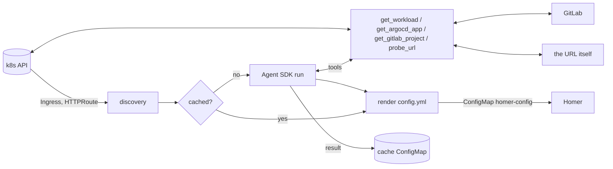

# rhapsode

Controller that fills [Homer](https://github.com/bastienwirtz/homer) with every public Ingress / Gateway API HTTPRoute in your cluster. A Claude Agent SDK agent works out what each URL powers before it is listed.



## How it works

- Every `RECONCILE_INTERVAL_S` (default 60) it lists Ingresses and HTTPRoutes. It polls instead of watching, which is simpler and fast enough for a dashboard.
- Each endpoint gets one short agent run, only when its host, backend, namespace or annotations changed. Results are cached in the `rhapsode-cache` ConfigMap, so steady state costs zero LLM calls.
- The agent only has four tools (no shell, no file access): backend workload info, the ArgoCD Application, the GitLab repo description/README, and a GET on the URL. The probe refuses any host that was not discovered from the cluster, and does not follow redirects.
- Output goes to ConfigMap `homer-config` (`config.yml`), merged over `/config/base.yml` (ConfigMap `homer-base`).

## "Public" means

Has a real, non-wildcard hostname, is not in `EXCLUDE_NAMESPACES`, does not end in `EXCLUDE_HOST_SUFFIXES`, and matches `PUBLIC_INGRESS_CLASSES` if you set it (e.g. `traefik-public`). Override per resource with the annotation `rhapsode/ignore: "true"|"false"`.

## LLM auth

| Mode | Env |
|------|-----|
| API key | `ANTHROPIC_API_KEY` |
| Bedrock | `CLAUDE_CODE_USE_BEDROCK=1`, `AWS_REGION`, AWS credentials, `AGENT_MODEL=<inference profile id>` |

## Run

```bash
# local dry run against your kubeconfig
pip install -e .
OUTPUT_PATH=./config.yml ANTHROPIC_API_KEY=... rhapsode --once

# in k3s
docker buildx build --platform linux/arm64 -t ghcr.io/<you>/rhapsode . --push
kubectl apply -f deploy/manifests.yaml
```

Homer side: mount the `homer-config` ConfigMap as a directory (not `subPath`) over `/www/assets`-style config path, or restart Homer after changes, because `subPath` mounts do not update live.

## Config env vars

`PUBLIC_INGRESS_CLASSES`, `EXCLUDE_NAMESPACES`, `EXCLUDE_HOST_SUFFIXES`, `HOMER_NAMESPACE`, `HOMER_CONFIGMAP`, `HOMER_BASE_CONFIG`, `OUTPUT_PATH`, `RECONCILE_INTERVAL_S`, `AGENT_CONCURRENCY`, `AGENT_MAX_TURNS`, `ARGOCD_NAMESPACE`, `GITLAB_URL`, `GITLAB_TOKEN`, `PROBE_VERIFY_TLS`, `AGENT_MODEL`.
