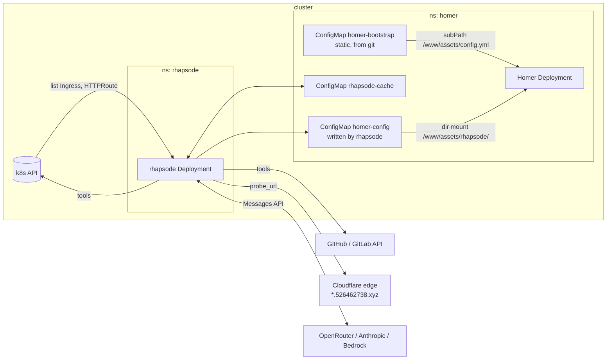
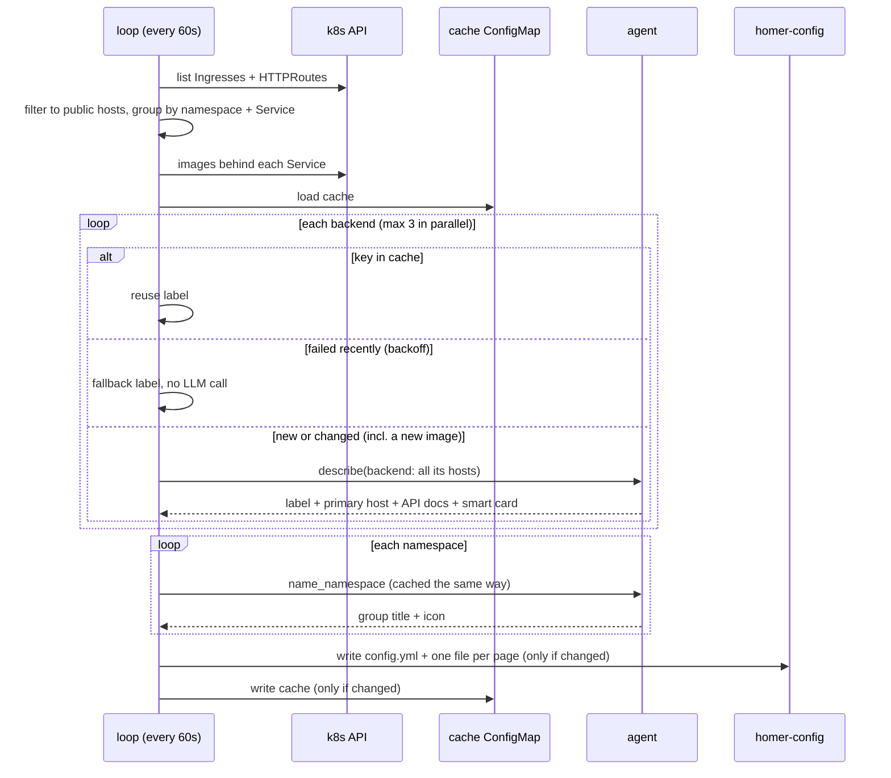
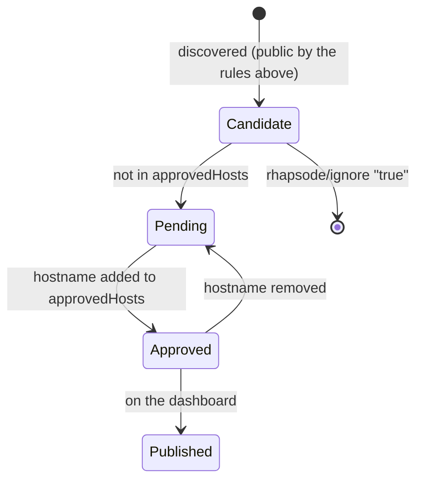
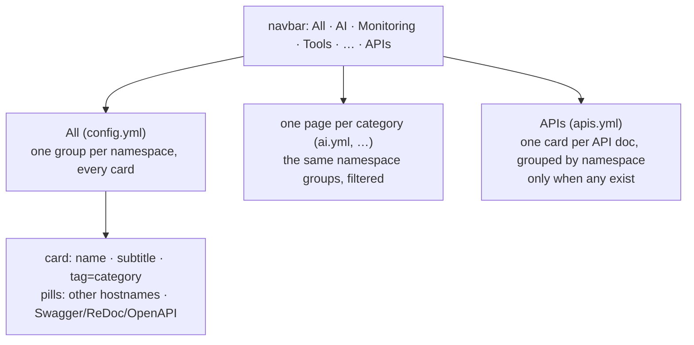
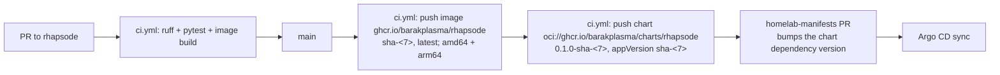

# rhapsode design

## Goal

A [Homer](https://github.com/bastienwirtz/homer) dashboard that lists every
public web endpoint on the cluster with a useful name, a one-line subtitle, a
category and an icon, and stays current with no manual edits.

A small LLM agent writes the labels. Kubernetes metadata alone usually only
gives `chhoto` and `ghcr.io/sintan1729/chhoto-url`. The agent turns that into
"Chhoto, URL shortener, Tools".

### Non-goals

- Health or uptime monitoring. Homer's own `connectivityCheck` covers "is it up".
- Access control. Homer is a static page. Put it behind Cloudflare Access like
  the other apps.
- Watching the API server. A 60 s poll is fast enough for a dashboard and needs
  no informer, resync or reconnect logic.
- Editing Homer's look. Title, theme and links live in a hand-written base file.

## Architecture



### Reconcile loop



## Discovery

An endpoint is one hostname. If several resources claim a host, the first one
in list order wins. Endpoints that share a namespace and a backend Service are
one **backend**: one agent run, one Homer card. Three hostnames for one Grafana
become one card, and the extra hostnames become link pills on it. A route with
no Service is a backend of its own.

**Through Traefik.** Several apps here sit behind an Ingress whose backend is
an ExternalName Service (`traefik-proxy`, pointing at Traefik), with the real
routing in a Traefik IngressRoute. That Ingress says nothing about the app: the
Service has no selector, no pods and no images. So for an endpoint whose
backend is an ExternalName Service, rhapsode looks up the IngressRoute rule
for its hostname and uses the Service that rule sends traffic to, in that
Service's own namespace. The first rule for the whole host decides (by
IngressRoute namespace and name). If it goes to something other than a plain
Service, such as a TraefikService (a weighted canary, `api@internal`), the host
stays unresolved, and a narrower rule must not stand in for it. A host with only
path- or header-limited rules resolves only when they all name the same Service,
because otherwise nothing says which app the host is. Rules may quote hostnames
with backticks or double quotes. An endpoint with no matching rule, whose Service
has a real backend, or whose route leads into an excluded namespace
(`EXCLUDE_NAMESPACES`; only the Ingress's own namespace was checked when it was
admitted) is left alone. The agent sees `via: Traefik IngressRoute <ns>/<name>`
on the endpoint.
Without this, the agent had no pods or images for those apps, a new release did
not trigger a relabel, and a host served by Grafana through Traefik could not be
merged with the Grafana Service the other hosts use. It needs `list` on
`traefik.io` `ingressroutes`. A missing CRD means no Traefik and is skipped; a
missing permission is logged as a warning and skipped, so upgrading the image
before the chart does not stop the dashboard. Only the `traefik.io` group is
read, not the older `traefik.containo.us`.

Two *Services* can still front the same pods (a second Service or Ingress added
for the same Grafana). So backends in one namespace whose Services have the
same pod selector are merged too, keeping the alphabetically first Service
name so the cache key is stable. A Service with no selector (ExternalName, or
hand-managed endpoints) is never merged, so those stay separate cards, told
apart by the host suffix when their names collide.

| Source | Backend | Scheme |
|---|---|---|
| `networking.k8s.io/v1` Ingress | the `/` path's Service, else the first path | `https` if the host is in `spec.tls`, else `http` |
| `gateway.networking.k8s.io/v1` HTTPRoute (optional CRD) | first `backendRef` | `https` |

On this cluster TLS ends at Cloudflare, so the tunnel Ingresses have no
`spec.tls`. Set `FORCE_HTTPS=true` to label every URL `https`.

**Public** means all of these are true:

- the hostname is real (not empty, no `*`);
- the namespace is not in `EXCLUDE_NAMESPACES`;
- the hostname does not end in `EXCLUDE_HOST_SUFFIXES`;
- the class is in `PUBLIC_INGRESS_CLASSES`, if set (`cloudflare-tunnel` here).

The annotation `rhapsode/ignore: "true"` drops a resource from discovery
entirely (it is not even listed as pending), and `"false"` makes it a
candidate. A candidate is not published until it is approved (next section).
The annotation is the escape hatch, so the rules can stay simple.

## Approval

"Public" is a guess made from cluster metadata. An Ingress for an admin UI, a
webhook or a service with no login of its own passes every rule above, and
the dashboard would then publish it. So discovery only finds **candidates**,
and nothing is published until a person approves its hostname.



- **Where approvals live:** the chart value `approvedHosts`, a list of exact
  hostnames (case-insensitive). In this homelab that is one list in
  `apps/rhapsode/values.yaml`, so every approval is a reviewed line in a pull
  request, and Argo CD applies it. Annotations on the Ingresses would be
  scattered across every app, and `charts/common` has no annotations field.
- **Default-deny:** an empty list publishes nothing. No wildcards: one would
  approve every future Ingress on that domain, which defeats the gate.
- **Per hostname, not per Service.** A backend with three hostnames gets a
  card from its approved hostnames only. An unapproved alias is not a pill and
  not a link target, and the agent's preferred primary host is replaced by the
  first approved one if it is not approved.
- **The pending list** is ConfigMap `rhapsode-pending` (key `pending.yaml`,
  sorted by hostname) and a log line whenever it changes. Each entry has the
  hostname, namespace, Service, container images, the agent's suggested label,
  and an `auth` hint. It is read with `kubectl`; it is deliberately not a
  Homer page, because Homer's pages are public and a pending list would
  publish exactly what the gate holds back.
- **The `auth` hint** comes from one unauthenticated GET to the public URL,
  without following redirects, cached for an hour:

  | `auth` | Meaning |
  |---|---|
  | `cloudflare-access` | redirected to Cloudflare Access |
  | `401`, `403` | the host refuses anonymous requests |
  | `login-redirect` | redirected to a path or host that looks like a login |
  | `no-auth-seen` | answered without asking for a login |
  | `unreachable` | no answer (not cached) |

  `no-auth-seen` is a signal to look closer, not proof: a login form rendered
  in place at a `200` looks the same.
- **The agent still runs for pending hosts**, so the list can show a suggested
  label. The cost is that details about a service you may not want public (its
  images, its repo README, a page snippet) are sent to the LLM provider. To
  avoid that, run the agent only for approved hosts. The pending list would
  then lack suggestions. This was a choice, not an oversight.
- **Namespace titles** are generated from approved cards only, so the titles
  of unapproved services never reach the dashboard through a group name.
- **A failure to write the pending list** is logged and does not stop the
  dashboard or cost the next loop its cache.

## The agent

One short Claude Agent SDK run per new or changed backend, and one tiny run per
namespace to title its group.

| Setting | Value | Why |
|---|---|---|
| `tools=[]` | no built-in tools | no shell, file or web access inside the container |
| `mcp_servers` | in-process server with the tools below | the agent can only do what these functions do |
| `setting_sources=[]`, `strict_mcp_config` | ignore any settings or `.mcp.json` on disk | behavior is fixed by code |
| `output_format` | JSON schema for the label | no regex parsing of prose |
| `max_turns` | 8 | bounds latency |
| `max_budget_usd` | 0.05 | a hard cost cap per run |

### Tools

| Tool | Reads | Guard |
|---|---|---|
| `get_workload(namespace, service)` | Service labels and annotations, ports, images and labels of one backing pod | Never returns env, args or Secrets |
| `get_argocd_app(name)` | `spec.source(s)` and `destination` of an Argo CD Application | Read-only, `argocd` namespace only |
| `get_repo(repo_url, path?)` | Repo description and topics, plus `README` or one file (e.g. `apps/chhoto/values.yaml`) | Only `github.com` and the configured `GITLAB_URL`. No `..` in the path. 3000 chars max |
| `probe_url(url)` | Status, `<title>`, a text snippet | Only discovered hosts. No redirects followed |
| `find_api_docs()` | Which of a fixed list of about 20 well-known doc paths (`/openapi.json`, `/v3/api-docs`, `/docs`, `/redoc`, `/swagger-ui/`, …) serve an OpenAPI/Swagger spec or a Swagger UI, ReDoc or Scalar page, and their titles | Only this run's own Service, in-cluster (`http://<svc>.<ns>.svc:<port>`), so a Cloudflare Access login is no obstacle. GET only, no redirects, 4 s timeout. Returns metadata, never the spec |

**Why in-cluster for API docs.** From outside, none of the 21 public hosts
serve docs at any of those paths. Some are behind Cloudflare Access, and the
docs of an API behind a login are the ones worth listing. The Homer link still
goes to the public host (`<primary host><path>`), so a person goes through
Access as usual.

Each probe logs `api docs probe <ns>/<svc>:<port> -> [paths]` (or `none`), so
"nothing found" can be told apart from "the agent never called it".

The usual path here is: workload, then the Argo CD app (named after the
namespace), then `get_repo` on `homelab-manifests` at `apps/<name>/values.yaml`.
That file usually names the upstream repo in its first comment, and the agent
can follow it with one more `get_repo` call.

`homelab-manifests` is private, so `get_repo` needs `GITHUB_TOKEN` (a
fine-grained PAT with `contents: read`). Without it the agent still has the
workload and the probe.

### Output contract

```json
{"name": "<=24", "subtitle": "<=60", "category": "Dev|Media|Monitoring|Data|AI|Infra|Home|Tools|Other",
 "icon": "fas fa-...", "keywords": "...", "confidence": 0.0, "hide": false,
 "primary_host": "<one of this backend's hosts>", "api_docs": ["/docs", "/openapi.json"],
 "smart_card": "|Gatus|Olivetin"}
```

The namespace run returns `{"title": "<=24", "icon": "fas fa-..."}` and falls
back to the raw namespace name.

Treat it as untrusted, even with a schema:

- strings are truncated to the limits;
- `icon` must match `^fa[a-z]* fa-[a-z0-9-]+$`, else `fas fa-link`;
- `category` falls back to `Other`;
- `primary_host` must be one of the backend's hosts, else the first;
- `api_docs` keeps only paths that `find_api_docs` itself confirmed in the same
  run (at most 3), so the model cannot add a link;
- `smart_card` must be on the allowlist (`Gatus`, `Olivetin`: cards that read a
  status or a version and need no API key in the public config) **and** a
  container image behind the Service must contain the product's name. Without
  the second check the model picked Gatus for a rehearsal chat app, which
  broke its card; with no known image there is no smart card;
- every URL is built from discovery plus a confirmed path, never taken from the
  model.

## Caching and cost

- Backend key: `b.<namespace>.<service>.` + `sha256(hosts, service, port,
  images, annotations)[:16]`. The label, primary host and API docs are redone
  when something that identifies the service changes, including a new
  container image (a release).
- Namespace key: `ns.<namespace>.` + a hash of its cards' names, subtitles and
  categories. The group title is redone when its members change.
- The cache is the `rhapsode-cache` ConfigMap, so it survives restarts. Entries
  for vanished backends and namespaces drop out on the next write.
- **Failure backoff.** A failed run is not cached, so the next pass would retry
  it, and a broken endpoint would cost an agent run every 60 s. Failures are
  kept in memory and retried after `FAILURE_BACKOFF_S` (30 min). The Homer
  entry uses a fallback label (host prefix + source) in the meantime.
- Steady state makes zero LLM calls. A cold start with about 15 hosts costs a
  few cents on Haiku.

## Output to Homer

Homer is a static SPA. The browser fetches `assets/config.yml` on each page
load. A ConfigMap mounted with `subPath` never updates in a running pod, and a
ConfigMap mounted as the whole `/www/assets` hides Homer's icons. So the
setup has two layers:

1. `homer-bootstrap` (from git) mounts with `subPath` at
   `/www/assets/config.yml`. Its only content is
   `externalConfig: assets/rhapsode/config.yml`. It never changes, so `subPath`
   is fine.
2. `homer-config` (written by rhapsode) mounts as a directory at
   `/www/assets/rhapsode/`. Directory mounts update live, within about a minute
   of the kubelet sync.

`externalConfig` replaces the config rather than merging into it, so rhapsode
writes a complete file: the base file `/config/base.yml` (ConfigMap
`homer-base`) plus the `services` it generates.

rhapsode can run in any namespace. Its write access is one Role in Homer's
namespace (the chart's `homerNamespace`), limited by `resourceNames` to
`homer-config` and `rhapsode-cache`. `create` can't be limited by name. On a
fresh cluster that Role can't be created until Homer's namespace exists. Argo
CD's next sync retry fixes that. rhapsode writes only when the content changed.

### Layout: pages and groups

Homer has one level of groups, each holding cards. It cannot nest groups. It
does offer two ways to nest without any change to Homer:

- **`quick` links:** small pills along the bottom of a card. Alias hostnames
  and API docs go there.
- **pages:** a navbar link `#rhapsode/ai` makes Homer fetch
  `assets/rhapsode/ai.yml` and shallow-merge it over the main config, so the
  page's `services` replace the main ones. The page files are extra keys in the
  same `homer-config` ConfigMap, so they land in the same directory mount.



- A group is a namespace, titled by the namespace run. Groups and cards are
  sorted by name.
- The category is the card's `tag`.
- Two different backends with the same name get their primary host's first
  label appended, for example "Grafana (metrics)".
- A smart card (`type: Gatus` / `Olivetin`) gets no subtitle, because a
  subtitle would hide the card's own status line. Smart cards call the app's
  API from the browser, so they show `?` until that app allows Homer's origin
  through CORS, or while it sits behind Cloudflare Access.

## Security

- **RBAC.** Cluster-wide `get, list` on Services, Pods, Ingresses, HTTPRoutes
  and Traefik IngressRoutes, plus `get` on Argo CD Applications. Write access only to its three
  ConfigMaps in `homer` (the Homer files, the cache, the pending list). No
  Secrets.
- **Prompt injection.** Every tool result is data an outsider may have written
  (a README, a page title). The worst case is a bad label, because:
  - the model can't reach anything beyond the five tools;
  - the probe can only hit hosts that are already public;
  - the output is validated;
  - the URL is never the model's.
- **SSRF.** `probe_url` checks the host against the discovered set and follows no
  redirects. `get_repo` has a fixed host list. `find_api_docs` takes no
  arguments: it reaches only the run's own Service, at fixed paths, and returns
  metadata, not response bodies. It can see past Cloudflare Access, because
  it calls the Service directly. In return, what it reports is a path that exists
  and a title, and the link it produces still goes through the public host.
- **Extra CAs (OpenShift trusted-ca).** The chart creates nothing. It mounts an
  existing ConfigMap (`trustedCAConfigMap`, default `trusted-ca`) as optional.
  On OpenShift that is the ConfigMap the cluster network operator injects the
  trust bundle into (proxy and private CAs) under `ca-bundle.crt`. An init
  container appends that file, if present, to certifi's roots, and
  `SSL_CERT_FILE` (httpx) and `NODE_EXTRA_CA_CERTS` (the CLI) point at the
  result. The merge is needed because `SSL_CERT_FILE` replaces the default
  roots. Where the ConfigMap is missing, the pod still starts with the public
  roots. The bundle is merged at pod start, so a rotated cluster CA needs a pod
  restart.
- **Accidental publication.** The approval gate (see Approval) keeps anything
  not on `approvedHosts` out of every Homer file, including pills and group
  titles. The LLM provider still sees pending hosts, as described there.
- **Container.** Runs as non-root with a read-only root filesystem. `HOME=/tmp`
  is an `emptyDir`, because the bundled Claude Code CLI writes session files
  there.
- **Cloudflare Access.** `probe_url` goes out through the public edge, so a host
  behind Access returns the Access login page. The prompt says so, and the
  agent leans on workload and repo data instead. Homer should also sit behind
  Access, because it is a map of everything that is exposed.

## LLM backends

Auth comes from the environment, through the bundled Claude Code CLI:

| Backend | Env |
|---|---|
| OpenRouter (homelab default) | `ANTHROPIC_BASE_URL=https://openrouter.ai/api`, `ANTHROPIC_AUTH_TOKEN`, `ANTHROPIC_API_KEY=""`, `AGENT_MODEL=anthropic/claude-haiku-5.5` |
| Anthropic | `ANTHROPIC_API_KEY`, optional `AGENT_MODEL` |
| Bedrock | `CLAUDE_CODE_USE_BEDROCK=1`, `AWS_REGION`, AWS creds, `AGENT_MODEL=<inference profile id>` |

## Delivery



- The image is multi-arch (the cluster node is arm64) and carries SBOM and
  provenance attestations. `v*` git tags also publish semver tags.
- The Helm chart (`charts/rhapsode`) is the only deploy artifact. It ships as
  an OCI artifact, published after the image so that its `appVersion` always
  names an image that exists. One version string pins both.
- The image is public on GHCR, because the repo is public, so no `ghcr-pull`
  Secret is needed.
- `homelab-manifests` wraps the chart as a dependency (`apps/rhapsode`), pinned
  to a `-sha-<7>` version, following its `test_image_pull_policy.py` rule. A bump workflow like `bump-aura.yml` can come
  later if the manual bumps get tedious.

## Open questions

1. A liveness probe. There is no HTTP server today. A heartbeat file plus an
   `exec` probe would catch a hung loop. Skipped until it happens.
2. Stale approvals: an `approvedHosts` entry whose hostname no longer exists is
   harmless but untidy. The pending ConfigMap could list them too.
3. Should low-`confidence` labels stand out (`tagstyle: is-warning`) for a
   manual `rhapsode/ignore` or a re-run? Today they are listed as-is.
4. A manual override annotation (`rhapsode/name`, `rhapsode/icon`) that skips the
   agent entirely. Cheap to add once there is a real case for it.
5. API docs of a Service exposed under a sub-path (an Ingress path other than
   `/`) are linked on the host root, so the link would be wrong. No such
   Ingress exists here today. Carry the path prefix through when one appears.
