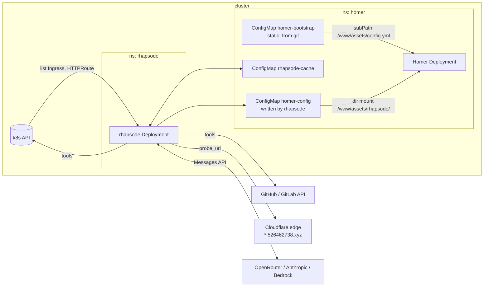
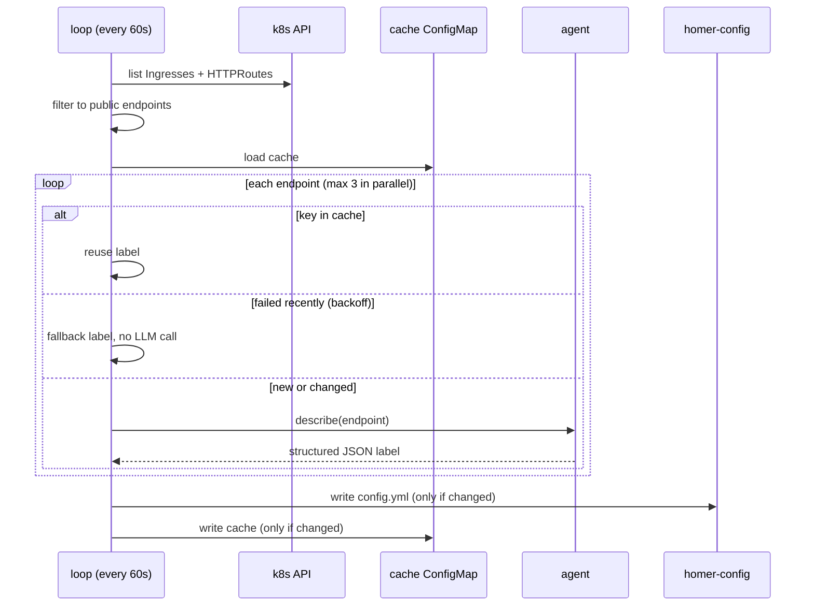
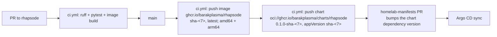

# rhapsode design

## Goal

A [Homer](https://github.com/bastienwirtz/homer) dashboard that lists every
public web endpoint on the cluster with a useful name, a one-line subtitle, a
category and an icon, and stays current with no manual edits.

A small LLM agent writes the labels. Kubernetes metadata alone usually only
gives `chhoto` and `ghcr.io/sintan1729/chhoto-url`. The agent turns that into
"Chhoto, URL shortener, Tools".

### Non-goals

- Health or uptime monitoring. Homer's own `connectivityCheck` covers "is it up".
- Access control. Homer is a static page. Put it behind Cloudflare Access like
  the other apps.
- Watching the API server. A 60 s poll is fast enough for a dashboard and needs
  no informer, resync or reconnect logic.
- Editing Homer's look. Title, theme and links live in a hand-written base file.

## Architecture



### Reconcile loop



## Discovery

An endpoint is one hostname. If several resources claim a host, the first one
in list order wins.

| Source | Backend | Scheme |
|---|---|---|
| `networking.k8s.io/v1` Ingress | the `/` path's Service, else the first path | `https` if the host is in `spec.tls`, else `http` |
| `gateway.networking.k8s.io/v1` HTTPRoute (optional CRD) | first `backendRef` | `https` |

On this cluster TLS ends at Cloudflare, so the tunnel Ingresses have no
`spec.tls`. Set `FORCE_HTTPS=true` to label every URL `https`.

**Public** means all of these are true:

- the hostname is real (not empty, no `*`);
- the namespace is not in `EXCLUDE_NAMESPACES`;
- the hostname does not end in `EXCLUDE_HOST_SUFFIXES`;
- the class is in `PUBLIC_INGRESS_CLASSES`, if set (`cloudflare-tunnel` here).

The annotation `rhapsode/ignore: "true"` hides a resource and `"false"` forces
it in. The annotation is the escape hatch, so the rules can stay simple.

## The agent

One short Claude Agent SDK run per new or changed endpoint.

| Setting | Value | Why |
|---|---|---|
| `tools=[]` | no built-in tools | no shell, file or web access inside the container |
| `mcp_servers` | in-process server with the tools below | the agent can only do what these functions do |
| `setting_sources=[]`, `strict_mcp_config` | ignore any settings or `.mcp.json` on disk | behavior is fixed by code |
| `output_format` | JSON schema for the label | no regex parsing of prose |
| `max_turns` | 8 | bounds latency |
| `max_budget_usd` | 0.05 | a hard cost cap per endpoint |

### Tools

| Tool | Reads | Guard |
|---|---|---|
| `get_workload(namespace, service)` | Service labels and annotations, ports, images and labels of one backing pod | Never returns env, args or Secrets |
| `get_argocd_app(name)` | `spec.source(s)` and `destination` of an Argo CD Application | Read-only, `argocd` namespace only |
| `get_repo(repo_url, path?)` | Repo description and topics, plus `README` or one file (e.g. `apps/chhoto/values.yaml`) | Only `github.com` and the configured `GITLAB_URL`. No `..` in the path. 3000 chars max |
| `probe_url(url)` | Status, `<title>`, a text snippet | Only discovered hosts. No redirects followed |

The usual path here is: workload, then the Argo CD app (named after the
namespace), then `get_repo` on `homelab-manifests` at `apps/<name>/values.yaml`.
That file usually names the upstream repo in its first comment, and the agent
can follow it with one more `get_repo` call.

`homelab-manifests` is private, so `get_repo` needs `GITHUB_TOKEN` (a
fine-grained PAT with `contents: read`). Without it the agent still has the
workload and the probe.

### Output contract

```json
{"name": "<=24", "subtitle": "<=60", "category": "Dev|Media|Monitoring|Data|AI|Infra|Home|Tools|Other",
 "icon": "fas fa-...", "tag": "<=12", "keywords": "...", "confidence": 0.0, "hide": false}
```

Treat it as untrusted, even with a schema:

- strings are truncated to the limits;
- `icon` must match `^fa[a-z]* fa-[a-z0-9-]+$`, else `fas fa-link`;
- `category` falls back to `Other`;
- `url` always comes from discovery and never from the model.

## Caching and cost

- Cache key: `host` + `sha256(url, backend, namespace, annotations)[:16]`. The
  label is only redone when something that identifies the service changes.
- The cache is the `rhapsode-cache` ConfigMap, so it survives restarts. Entries
  for vanished hosts drop out on the next write.
- **Failure backoff.** A failed run is not cached, so the next pass would retry
  it, and a broken endpoint would cost an agent run every 60 s. Failures are
  kept in memory and retried after `FAILURE_BACKOFF_S` (30 min). The Homer
  entry uses a fallback label (host prefix + source) in the meantime.
- Steady state makes zero LLM calls. A cold start with about 15 hosts costs a
  few cents on Haiku.

## Output to Homer

Homer is a static SPA. The browser fetches `assets/config.yml` on each page
load. A ConfigMap mounted with `subPath` never updates in a running pod, and a
ConfigMap mounted as the whole `/www/assets` hides Homer's icons. So the
setup has two layers:

1. `homer-bootstrap` (from git) mounts with `subPath` at
   `/www/assets/config.yml`. Its only content is
   `externalConfig: assets/rhapsode/config.yml`. It never changes, so `subPath`
   is fine.
2. `homer-config` (written by rhapsode) mounts as a directory at
   `/www/assets/rhapsode/`. Directory mounts update live, within about a minute
   of the kubelet sync.

`externalConfig` replaces the config rather than merging into it, so rhapsode
writes a complete file: the base file `/config/base.yml` (ConfigMap
`homer-base`) plus the `services` it generates.

rhapsode can run in any namespace. Its write access is one Role in Homer's
namespace (the chart's `homerNamespace`), limited by `resourceNames` to
`homer-config` and `rhapsode-cache`. `create` can't be limited by name. On a
fresh cluster that Role can't be created until Homer's namespace exists. Argo
CD's next sync retry fixes that.
rhapsode writes it only when the content changed.

## Security

- **RBAC.** Cluster-wide `get, list` on Services, Pods, Ingresses and
  HTTPRoutes, plus `get` on Argo CD Applications. Write access only to its two
  ConfigMaps in `homer`. No Secrets.
- **Prompt injection.** Every tool result is data an outsider may have written
  (a README, a page title). The worst case is a bad label, because:
  - the model can't reach anything beyond the four tools;
  - the probe can only hit hosts that are already public;
  - the output is validated;
  - the URL is never the model's.
- **SSRF.** `probe_url` checks the host against the discovered set and follows no
  redirects. `get_repo` has a fixed host list.
- **Extra CAs (OpenShift trusted-ca).** The chart creates nothing. It mounts an
  existing ConfigMap (`trustedCAConfigMap`, default `trusted-ca`) as optional.
  On OpenShift that is the ConfigMap the cluster network operator injects the
  trust bundle into (proxy and private CAs) under `ca-bundle.crt`. An init
  container appends that file, if present, to certifi's roots, and
  `SSL_CERT_FILE` (httpx) and `NODE_EXTRA_CA_CERTS` (the CLI) point at the
  result. The merge is needed because `SSL_CERT_FILE` replaces the default
  roots. Where the ConfigMap is missing, the pod still starts with the public
  roots. The bundle is merged at pod start, so a rotated cluster CA needs a pod
  restart.
- **Container.** Runs as non-root with a read-only root filesystem. `HOME=/tmp`
  is an `emptyDir`, because the bundled Claude Code CLI writes session files
  there.
- **Cloudflare Access.** `probe_url` goes out through the public edge, so a host
  behind Access returns the Access login page. The prompt says so, and the
  agent leans on workload and repo data instead. Homer should also sit behind
  Access, because it is a map of everything that is exposed.

## LLM backends

Auth comes from the environment, through the bundled Claude Code CLI:

| Backend | Env |
|---|---|
| OpenRouter (homelab default) | `ANTHROPIC_BASE_URL=https://openrouter.ai/api`, `ANTHROPIC_AUTH_TOKEN`, `ANTHROPIC_API_KEY=""`, `AGENT_MODEL=anthropic/claude-haiku-5.5` |
| Anthropic | `ANTHROPIC_API_KEY`, optional `AGENT_MODEL` |
| Bedrock | `CLAUDE_CODE_USE_BEDROCK=1`, `AWS_REGION`, AWS creds, `AGENT_MODEL=<inference profile id>` |

## Delivery



- The image is multi-arch (the cluster node is arm64) and carries SBOM and
  provenance attestations. `v*` git tags also publish semver tags.
- The Helm chart (`charts/rhapsode`) is the only deploy artifact. It ships as
  an OCI artifact, published after the image so that its `appVersion` always
  names an image that exists. One version string pins both.
- The image is public on GHCR, because the repo is public, so no `ghcr-pull`
  Secret is needed.
- `homelab-manifests` wraps the chart as a dependency (`apps/rhapsode`), pinned
  to a `-sha-<7>` version, following its `test_image_pull_policy.py` rule. A bump workflow like `bump-aura.yml` can come
  later if the manual bumps get tedious.

## Open questions

1. A liveness probe. There is no HTTP server today. A heartbeat file plus an
   `exec` probe would catch a hung loop. Skipped until it happens.
2. Should low-`confidence` labels be tagged (`tag: "?"`) so they stand out for
   a manual `rhapsode/ignore` or a re-run? Today they are listed as-is.
3. A manual override annotation (`rhapsode/name`, `rhapsode/icon`) that skips the
   agent entirely. Cheap to add once there is a real case for it.
